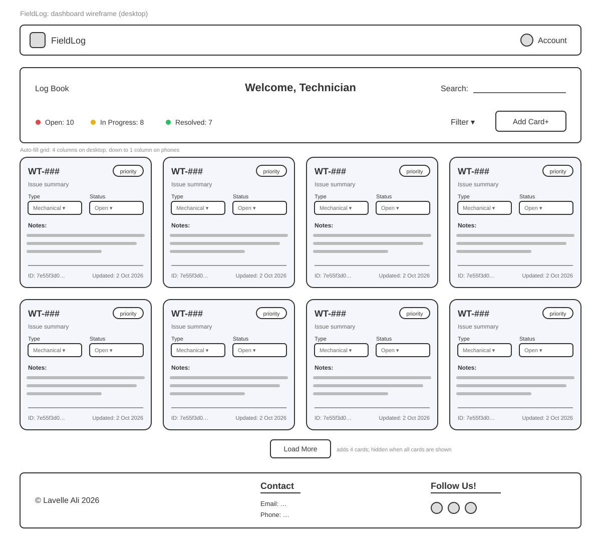

# FieldLog

FieldLog is an equipment-issue tracker for wind turbine maintenance crews. Technicians log issues with a priority, supervisors see what is open, in progress and resolved, and every status change and note is recorded so the next shift knows where things stand.

## Wireframe



The wireframe is also at [docs/dashboard-wireframe.svg](docs/dashboard-wireframe.svg).

## User stories

The three user stories are on the About page: `/about` in the app, or [app/about/page.tsx](app/about/page.tsx) in the code.

## Features

**Built so far**

- Issue board that shows each issue as a card: turbine ID, summary, priority, type, status, notes, ID and last-updated date
- Responsive card grid: four columns on desktop, down to one on phones
- Load More button that shows 4 more cards per click and hides once every card is shown
- Dashboard header with a welcome message and Open, In Progress and Resolved status indicators
- Navbar with the FieldLog logo and an Account page
- Light and dark colour scheme that follows the device setting
- 25 fictional seed issues

**Planned**

- Create Card form that adds a new issue to the board
- Live issue counts calculated from the data
- Search, and sorting by created date, updated date, ID, title, type and status (updated date by default)
- Saving status changes and notes
- Log Book page

## Tech stack

- [Next.js 16](https://nextjs.org) (App Router)
- [React 19](https://react.dev)
- [TypeScript](https://www.typescriptlang.org)
- [Tailwind CSS 4](https://tailwindcss.com)
- [Font Awesome](https://fontawesome.com) icons
- Deployed on [Vercel](https://vercel.com)

## Getting started

You need [Node.js](https://nodejs.org) 20 or later.

```bash
npm install
npm run dev
```

Then open [http://localhost:3000](http://localhost:3000). If port 3000 is already in use, Next picks the next free port and prints it in the terminal.

Other scripts:

| Command | What it does |
| --- | --- |
| `npm run build` | Builds the production version |
| `npm run start` | Runs the production build |
| `npm run lint` | Checks the code with ESLint |
| `npx tsc --watch` | Type-checks the project every time a file is saved |

## Project structure

```
app/            Pages: / (issue board), /about, /account, /logbook
components/     NavBar, Footer, Dashboard, AssessmentCards (issue cards)
data/           Fleetdata.ts: the Turbine type and the seed issues
docs/           Wireframe and other planning material
public/         Logo and icon files
```

## Data model

Each issue follows the `Turbine` interface in [data/Fleetdata.ts](data/Fleetdata.ts):

| Field | Type | Notes |
| --- | --- | --- |
| `id` | `string` | Unique ID from `crypto.randomUUID()` |
| `title` | `string` | Turbine ID, for example `WT-037` |
| `equipment` | `string` | Short summary of the issue |
| `priority` | `"low" \| "medium" \| "high"` | |
| `type` | `"mechanical" \| "hydraulic" \| "electrical"` | |
| `status` | `"open" \| "in progress" \| "resolved"` | |
| `notes` | `string` | Details of the problem or how it was fixed |
| `createdAt` | `string` | ISO date, set once when the issue is logged |
| `updatedAt` | `string` | ISO date, updated on every change |
